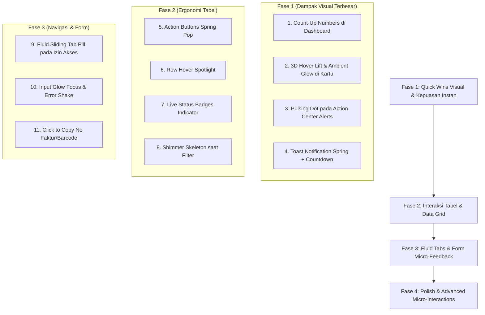

# Roadmap Modernisasi UI & Desain Animasi — POS Apotek

Dokumen ini memuat **22 saran peningkatan visual, mikro-animasi (*micro-interactions*), dan estetika modern** untuk mentransformasi antarmuka POS Apotek dari tampilan yang datar (*flat/boxy*) menjadi aplikasi web kelas atas yang hidup, responsif, dan berkesan mewah (*state-of-the-art*).

---

## Ringkasan 4 Pilar Utama Pengembangan

```text
┌────────────────────────────────────────────────────────────────────────┐
│                      PETA PENGEMBANGAN UI/UX                           │
├────────────────────┬────────────────────┬──────────────────────────────┤
│ 1. Dashboard (6)   │ 2. Tabel Data (6)  │ 3. Form & Input (5)          │
│ • Count-Up Numbers │ • Spring Buttons   │ • Active Glow Focus          │
│ • Hover Glow Lift  │ • Row Hover Focus  │ • Error Shake Feedback       │
│ • Pulsing Radar    │ • Shimmer Skeleton │ • Morphing Password Icon     │
│ • Staggered Charts │ • Live Status Dots │ • Drag-Drop Wave Ripple      │
│ • Trend Micro-Icon │ • Click-to-Copy    │ • Real-time Terbilang Nomina │
│ • Live Clock/Greet │ • Floating Actions │                              │
├────────────────────┴────────────────────┴──────────────────────────────┤
│ 4. Navigasi, Modal & Transisi (5)                                      │
│ • Fluid Sliding Tab Pill    • Modal Depth of Field & Tilt              │
│ • Spring Accordion Sidebar  • Floating Toast with Timer Bar            │
│ • Global Keyboard Cheatsheet (`?`)                                     │
└────────────────────────────────────────────────────────────────────────┘
```

---

## PILAR 1: Dashboard & Visual Analytics (Kesan Pertama yang WOW)

### 1. Animated Number Counter (*Count-Up Animation*) `[SELESAI]`
* **Prioritas:** ⭐⭐⭐ (Tinggi) | **Kompleksitas:** Rendah
* **Status:** Selesai diimplementasikan pada KPI Dashboard dengan `count-up.js` & `IntersectionObserver`.
* **Kondisi Saat Ini:** Angka KPI (*Total Omset*, *Laba*, *Total Transaksi*, *Obat Habis*) langsung muncul diam seketika saat halaman dibuka.
* **Saran Peningkatan:**
  Saat dashboard pertama kali dimuat, angka berputar menghitung cepat dari angka 0 ke nilai target (contoh: Rp 0 &rarr; Rp 14.850.000) dalam durasi 0,8 detik dengan kurva akselerasi *ease-out*.
* **Manfaat:** Memberikan kepuasan visual seketika bagi pemilik apotek saat membuka dashboard.

### 2. 3D Hover Lift & Colored Ambient Glow pada Kartu KPI `[SELESAI]`
* **Prioritas:** ⭐⭐⭐ (Tinggi) | **Kompleksitas:** Rendah
* **Status:** Selesai diimplementasikan di `app.css` dengan `cubic-bezier(0.16, 1, 0.3, 1)`, lift -4px, ambient colored glow, dan icon tilt rotation.
* **Kondisi Saat Ini:** Kartu KPI berlatar putih dengan border abu-abu flat. Tidak ada respon saat disorot kursor.
* **Saran Peningkatan:**
  Saat kursor diarahkan ke kartu:
  - Kartu sedikit terangkat ke atas setinggi 4px (`hover:-translate-y-1`).
  - Muncul bayangan berpendar lembut berwarna senada (*colored ambient shadow*):
    - Kartu Penjualan: pendar lembut biru-indigo (`shadow-indigo-500/15`).
    - Kartu Laba: pendar hijau zamrud (`shadow-emerald-500/15`).
    - Kartu Hutang/Jatuh Tempo: pendar amber/merah (`shadow-rose-500/15`).

### 3. Radar Status Berdenyut (*Pulsing Live Dot*) pada Action Center `[SELESAI]`
* **Prioritas:** ⭐⭐⭐ (Tinggi) | **Kompleksitas:** Sangat Rendah
* **Status:** Selesai diimplementasikan di Action Center dashboard dengan badge pinging radar dot.
* **Kondisi Saat Ini:** Alert box (Obat Kadaluarsa, Stok Habis) berlatar warna statis.
* **Saran Peningkatan:**
  Di samping judul peringatan, disematkan titik lampu kecil yang memancarkan gelombang berdenyut melingkar (*pinging wave dot*).
* **Manfaat:** Menegaskan bahwa Action Center adalah radar pemantau darurat yang bekerja *real-time*.

### 4. Entry Stagger pada Chart Grafik Penjualan & Tooltip Modern `[SELESAI]`
* **Prioritas:** ⭐⭐ (Sedang) | **Kompleksitas:** Sedang
* **Status:** Selesai diimplementasikan pada grafik omzet, profit, dan doughnut charts dengan easing cubic quart, rotation, scale animation, dan modern dark frosted tooltips.
* **Kondisi Saat Ini:** Grafik Chart.js muncul sekaligus.
* **Saran Peningkatan:**
  Batang diagram penjualan tumbuh bertahap dari kiri ke kanan (*staggered bar growth*), dipadukan dengan tooltip hover bergaya *frosted glass* (latar hitam transparan blur dengan teks monospaced kontras tinggi).

### 5. Metric Trend Micro-Badges Dinamis `[SELESAI]`
* **Prioritas:** ⭐⭐ (Sedang) | **Kompleksitas:** Rendah
* **Status:** Selesai diimplementasikan di `kpi-card.blade.php` dengan badge pill tren hijau/merah dinamis, kurva pegas, dan ikon panah melompat halus (`translate-y`) saat kartu disorot kursor, terintegrasi langsung dengan delta perbandingan periode di `DashboardController`.
* **Kondisi Saat Ini:** Perbandingan omset hari ini vs kemarin hanya angka teks biasa.
* **Saran Peningkatan:**
  Menambahkan pill badge persentase kecil (+12.4% atau -3.2%) dengan panah indikator yang sedikit melompat halus saat kartu disorot mouse.

### 6. Dynamic Time-Aware Greeting & Jam Digital Halus `[DIBATALKAN / DIHAPUS]`
* **Prioritas:** ⭐ (Rendah) | **Kompleksitas:** Rendah
* **Status:** Dihapus sesuai permintaan pengguna agar header dashboard tetap bersih, ringkas, dan fokus.
* **Kondisi Saat Ini:** Header dashboard mempertahankan judul resmi "Dashboard" dengan deskripsi ringkasan operasional.

---

## PILAR 2: Tabel & Pengolahan Data Harian

### 7. Action Buttons Spring Hover & Magnetic Pop `[SELESAI]`
* **Prioritas:** ⭐⭐⭐ (Tinggi) | **Kompleksitas:** Rendah
* **Status:** Selesai diimplementasikan di `table-action.blade.php` dengan `transform hover:scale-110 active:scale-95 transition-all duration-150 hover:shadow-xs`.
* **Kondisi Saat Ini:** Tombol ikon di kolom aksi tabel (Detail, Edit, Hapus) hanya berganti warna latar saat di-hover.
* **Saran Peningkatan:**
  Setiap tombol aksi membal lembut dengan efek pegas elastis (`hover:scale-115 active:scale-95 transition-transform duration-150`).

### 8. Interactive Row Hover Spotlight (*Fokus Baris Aktif*) `[SELESAI]`
* **Prioritas:** ⭐⭐ (Sedang) | **Kompleksitas:** Rendah
* **Status:** Selesai diimplementasikan di `app.css` dengan aksen garis biru kiri (`box-shadow: inset 3.5px 0 0 #2563eb`) dan gradien sorot biru es lembut pada `.table-custom-body tr:hover` dan `.table-compact tbody tr:hover`.
* **Kondisi Saat Ini:** Baris tabel berselang-seling abu-abu/putih datar.
* **Saran Peningkatan:**
  Saat baris disorot:
  - Latar baris berganti menjadi gradien putih ke biru es tipis (`bg-gradient-to-r from-blue-50/60 to-transparent`).
  - Baris lain di atas dan bawahnya meredup sangat halus (`opacity-90`), memudahkan mata operator membaca baris obat/harga yang panjang tanpa salah baris.

### 9. Shimmer Skeleton Loading pada Live Filter & Pencarian `[SELESAI]`
* **Prioritas:** ⭐⭐⭐ (Tinggi) | **Kompleksitas:** Sedang
* **Status:** Selesai diimplementasikan pada `card-filter.blade.php` dan `app.css` dengan kelas `.table-custom-container.is-filtering`, animasi gelombang sapuan kilau `@keyframes tableShimmerGlow`, dan bilah loading indeterminate biru modern tanpa layout shift (CLS 0).
* **Kondisi Saat Ini:** Saat mengetik filter pencarian, tabel menampilkan animasi shimmer wave halus dan bilah progress bar dinamis saat data diambil via AJAX.

### 10. Glowing Status Indicator pada Badge Tabel `[SELESAI]`
* **Prioritas:** ⭐⭐ (Sedang) | **Kompleksitas:** Rendah
* **Status:** Selesai diimplementasikan di `badge.blade.php` dan `status-badge.blade.php` dengan live glowing dot status untuk semua status (Aman, Menipis, Habis, Lunas, dsb.).
* **Kondisi Saat Ini:** Badge `Aman`, `Menipis`, `Habis`, `Lunas` menggunakan badge warna standar.
* **Saran Peningkatan:**
  Menyematkan titik lampu kecil di samping teks:
  - Hijau (Aman / Lunas) &rarr; titik hijau stabil.
  - Kuning (Menipis) &rarr; titik kuning redup-terang.
  - Merah (Habis / Kadaluarsa) &rarr; titik merah berdenyut pelan.

### 11. Click-to-Copy Instan dengan Feedback Tooltip `[SELESAI]`
* **Prioritas:** ⭐⭐ (Sedang) | **Kompleksitas:** Rendah
* **Status:** Selesai diimplementasikan dengan engine `copy-to-clipboard.js`, styling bubble tooltip `copy-tooltip-bubble`, dan komponen `<x-copyable>` pada no faktur, invoice, dan kode obat.
* **Kondisi Saat Ini:** Kode Barcode / SKU / No Faktur harus diblok manual untuk disalin.
* **Saran Peningkatan:**
  Cukup klik sekali pada kode faktur/barcode:
  - Teks otomatis tersalin ke *clipboard*.
  - Muncul mini-tooltip melayang *"Tersalin! ✓"* selama 1 detik dengan animasi melompat ke atas.

### 12. Floating Batch Action Bar (*Bilah Aksi Mengambang*)
* **Prioritas:** ⭐ (Rendah) | **Kompleksitas:** Sedang
* **Kondisi Saat Ini:** Checkbox hapus/cetak massal belum memiliki wadah aksi yang elegan.
* **Saran Peningkatan:**
  Saat 1 atau lebih checkbox tabel dicentang, bilah hitam mengambang meluncur mulus dari bawah layar (*slide-up floating dock*): menampilkan jumlah item terpilih dan tombol aksi massal (*Hapus Terpilih*, *Cetak Label Terpilih*).

---

## PILAR 3: Formulir & Input Interaktif

### 13. Active Input Glow Focus & Micro-Highlight `[SELESAI]`
* **Prioritas:** ⭐⭐ (Sedang) | **Kompleksitas:** Rendah
* **Status:** Selesai diimplementasikan di `app.css` dengan `border-color: #2563eb; box-shadow: 0 0 0 3.5px rgba(37, 99, 235, 0.16)`.
* **Kondisi Saat Ini:** Input teks menggunakan ring border biru standar Tailwind.
* **Saran Peningkatan:**
  Saat kolom diklik/fokus, border berpendar dengan bayangan lembut berwarna biru apotek (`ring-4 ring-blue-500/10 border-blue-500`).

### 14. Error Shake Feedback pada Validasi Form `[SELESAI]`
* **Prioritas:** ⭐⭐ (Sedang) | **Kompleksitas:** Rendah
* **Status:** Selesai diimplementasikan di `app.css` (`@keyframes errorShake`) dan terhubung otomatis dengan validasi AJAX `modal-form.blade.php`.
* **Kondisi Saat Ini:** Pesan error hanya teks merah statis yang muncul mendadak.
* **Saran Peningkatan:**
  Jika user lupa mengisi field wajib atau format email salah: input bergetar horizontal halus selama 0,3 detik (*gentle horizontal shake animation*) untuk memanggil perhatian pengguna secara ergonomis.

### 15. Smooth Password Visibility Toggle `[SELESAI]`
* **Prioritas:** ⭐ (Rendah) | **Kompleksitas:** Rendah
* **Status:** Selesai diimplementasikan di `login.blade.php` dengan transisi rotasi 180° berdaya pegas dan hover scaling.
* **Kondisi Saat Ini:** Ikon mata ganti seketika.
* **Saran Peningkatan:**
  Ikon mata membuka dan menutup dengan transisi rotasi halus 180 derajat saat disorot/diklik.

### 16. Drag-and-Drop Area dengan Animasi Dash Border `[SELESAI]`
* **Prioritas:** ⭐ (Rendah) | **Kompleksitas:** Rendah
* **Status:** Selesai diimplementasikan di `app.css` dengan keyframe `@keyframes marchingAnts`, modul `dropzone.js`, dan dropzone responsif pada modal import CSV barang dan modal restore SQL database lengkap dengan live file name preview.
* **Kondisi Saat Ini:** Kotak unggah file logo apotek atau file restore database berbentuk garis putus-putus statis.
* **Saran Peningkatan:**
  Saat file ditarik (*drag over*) ke atas kotak, garis putus-putus berputar lambat mengelilingi kotak (*rotating marching ants border animation*).

### 17. Live Currency Auto-Format dengan Terbilang Real-Time `[SELESAI]`
* **Prioritas:** ⭐⭐ (Sedang) | **Kompleksitas:** Rendah
* **Status:** Selesai diimplementasikan dengan engine `terbilang.js` dan selector `[data-terbilang="true"]`, otomatis menampilkan micro-card teks terbilang real-time (contoh: *"Lima belas juta rupiah"*) pada input pembayaran penerimaan, modal piutang member, dan biaya operasional.
* **Kondisi Saat Ini:** Kasir/admin mengetik angka harga/bayar tanpa indikator pengucapan.
* **Saran Peningkatan:**
  Saat mengetik nominal uang besar (misal penerimaan faktur supplier Rp 15.000.000), di bawah kolom input muncul teks terbilang berjalan: *"Lima belas juta rupiah"*.

---

## PILAR 4: Navigasi, Modal & Transisi Layar

### 18. Fluid Sliding Tab Indicator (*Tab Berselancar Halus*) `[SELESAI]`
* **Prioritas:** ⭐⭐⭐ (Tinggi) | **Kompleksitas:** Sedang
* **Status:** Selesai diimplementasikan di `permission/index.blade.php` dengan sliding pill indicator `#permission-tab-indicator` dan transisi `cubic-bezier(0.16, 1, 0.3, 1)`.
* **Kondisi Saat Ini:** Di halaman `/izin-akses`, tombol tab berganti kelas secara mendadak.
* **Saran Peningkatan:**
  Latar belakang tab aktif berupa pill putih/biru yang **meluncur mulus secara fisik (*sliding spring transition*)** dari tab satu ke tab lainnya (gaya navigasi iOS / macOS).

### 19. Accordion Sidebar Berdaya Pegas (*Spring Motion*) `[SELESAI]`
* **Prioritas:** ⭐⭐ (Sedang) | **Kompleksitas:** Rendah
* **Status:** Selesai diimplementasikan di `sidebar-group.blade.php` dengan kurva pegas `cubic-bezier(0.16, 1, 0.3, 1)` pada rotasi chevron dan expanding submenus.
* **Kondisi Saat Ini:** Dropdown menu sidebar (Master Data, Laporan) terbuka secara instan.
* **Saran Peningkatan:**
  Submenu bergulir membuka ke bawah dengan transisi ketinggian halus (*smooth height expansion*) dan panah panji berputar lembut 90 derajat.

### 20. Enhanced Modal Backdrop Blur & 3D Scale In `[SELESAI]`
* **Prioritas:** ⭐⭐ (Sedang) | **Kompleksitas:** Rendah
* **Status:** Selesai diimplementasikan di `app.css` (`backdrop-filter: blur(5px)` dan `@keyframes modalScaleIn`) berlaku otomatis untuk semua modal sistem.
* **Kondisi Saat Ini:** Modal muncul dengan skala zoom standar.
* **Saran Peningkatan:**
  Latar belakang menggunakan efek blur kabut yang lebih dalam (`backdrop-blur-md bg-slate-950/60`), dan kartu modal masuk dari skala 0.96 ke 1.0 dengan pantulan pegas halus.

### 21. Toast Notification dengan Spring Bounce & Countdown Bar `[SELESAI]`
* **Prioritas:** ⭐⭐⭐ (Tinggi) | **Kompleksitas:** Rendah
* **Status:** Selesai diimplementasikan di `toast.blade.php` dengan animasi `@keyframes toastSpringIn` dan garis timer bar menyusut 4 detik.
* **Kondisi Saat Ini:** Toast notifikasi muncul dan hilang secara standar.
* **Saran Peningkatan:**
  - Toast jatuh dari atas layar dengan efek membal lembut (*soft spring entrance*).
  - Di tepi paling bawah toast terdapat garis tipis yang menyusut perlahan selama 4 detik (*timer progress countdown*), memberi tahu pengguna kapan notifikasi akan tertutup otomatis.

### 22. Interactive Keyboard Shortcut Guide (`?` or `Ctrl + /`) `[SELESAI]`
* **Prioritas:** ⭐ (Rendah) | **Kompleksitas:** Rendah
* **Status:** Selesai diimplementasikan dengan komponen `<x-keyboard-shortcut-modal>` di layout utama, deteksi shortcut tombol `?` dan `Ctrl + /`, serta kartu tuts `<kbd>` fisik.
* **Kondisi Saat Ini:** Pengguna tidak tahu shortcut apa saja yang tersedia (kecuali Ctrl+K).
* **Saran Peningkatan:**
  Menekan tanda tanya (`?`) membuka modal panduan shortcut elegan bergaya kartu tuts keyboard Mac/Windows.

---

## Urutan Rencana Eksekusi Bertahap (Sprint Roadmap)



---

> **Prinsip Teknis:**
> Semua animasi ini dirancang **ringan (*lightweight*)**, menggunakan **CSS Transforms & Opacity hardware-accelerated** (60 FPS) tanpa membebani browser kasir, dan tidak memerlukan dependensi pustaka berat dari luar.
